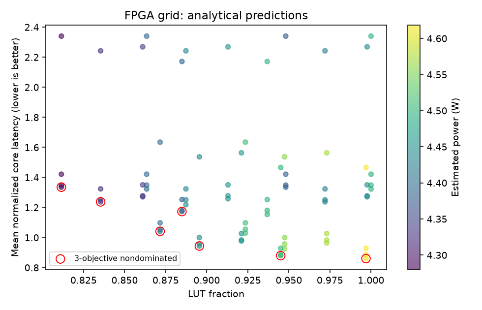
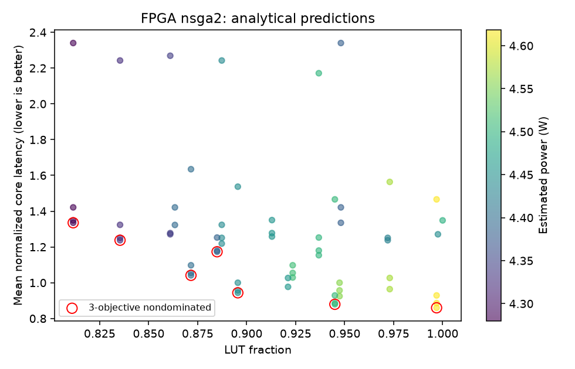
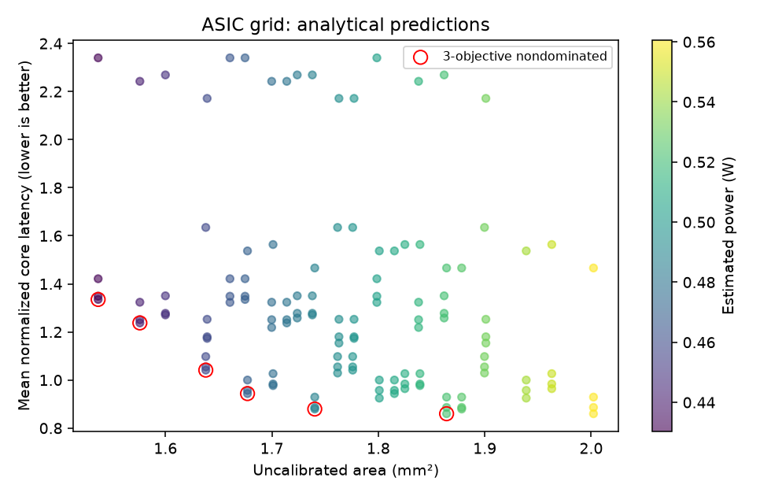
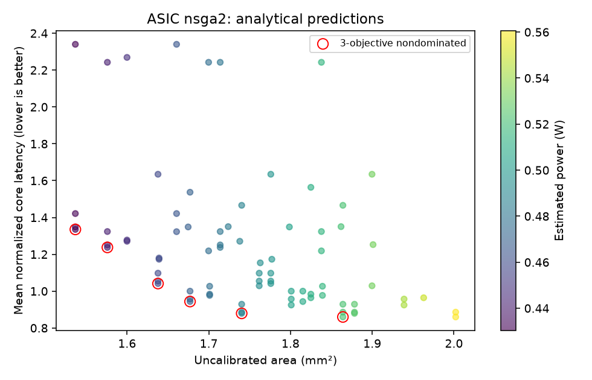

# openDARS analytical exploration report

## Evidence and validation

Runtime: W8A8, FP32 state, core busy time (not host latency). openTARS source revision: `36af670d9df0f211d5b6377505f3311c410d33f8`.
The lowering test compares 12 real descriptor queues, excluding GEMM row-scale addresses.
Fit: Qwen3/Qwen3.5 per-class counters, decode and 5/20-token prefill. Qwen3 t=8 is excluded as a documented one-off outlier. Gemma3 and baseline/repeat measurements never enter fitting.

- Training total-cycle MAPE: 0.30%; maximum: 0.74%.
- Gemma holdout MAPE: 4.20%; maximum: 4.72%.
- Other excluded/repeat/baseline maximum error: 6.34%.
- Training per-class maximum absolute error: 8.02%.
- Per-class errors are preserved in `validation.json`; total accuracy can hide class errors.
- These are empirical errors, not confidence intervals or hardware extrapolation guarantees.

| Dataset | Workload | Measured ms | Predicted ms | Error |
|---|---|---:|---:|---:|
| qwen3_profile.json | prefill 5 tokens | 179.071 | 179.354 | +0.16% |
| qwen3_profile.json | decode t=0 | 65.097 | 65.247 | +0.23% |
| qwen3_profile.json | decode t=4 | 65.149 | 65.247 | +0.15% |
| qwen3_profile.json | decode t=8 | 69.666 | 65.247 | -6.34% |
| qwen3_profile.json | decode t=16 | 67.104 | 67.210 | +0.16% |
| qwen3_profile.json | decode t=64 | 73.252 | 73.100 | -0.21% |
| qwen3_profile.json | decode t=128 | 81.206 | 80.954 | -0.31% |
| qwen3_profile.json | decode t=192 | 89.180 | 88.807 | -0.42% |
| qwen3_profile.json | decode t=250 | 95.186 | 94.697 | -0.51% |
| qwen3_prefill20.json | prefill 20 tokens | 577.235 | 578.391 | +0.20% |
| qwen3_baseline.json | prefill 5 tokens | 179.009 | 179.354 | +0.19% |
| qwen3_baseline.json | decode t=16 | 67.047 | 67.210 | +0.24% |
| qwen3_baseline.json | decode t=64 | 73.177 | 73.100 | -0.11% |
| qwen3_baseline.json | decode t=128 | 81.154 | 80.954 | -0.25% |
| qwen3_baseline.json | decode t=192 | 89.176 | 88.807 | -0.41% |
| qwen3_baseline.json | decode t=250 | 95.133 | 94.697 | -0.46% |
| qwen3_repeat.json | decode t=16 | 67.150 | 67.210 | +0.09% |
| qwen3_repeat.json | decode t=250 | 95.707 | 94.697 | -1.06% |
| qwen35_profile.json | prefill 5 tokens | 487.043 | 484.025 | -0.62% |
| qwen35_profile.json | decode t=0 | 131.344 | 131.266 | -0.06% |
| qwen35_profile.json | decode t=4 | 131.375 | 131.266 | -0.08% |
| qwen35_profile.json | decode t=8 | 131.334 | 131.266 | -0.05% |
| qwen35_profile.json | decode t=16 | 131.639 | 131.638 | -0.00% |
| qwen35_profile.json | decode t=64 | 132.581 | 132.752 | +0.13% |
| qwen35_profile.json | decode t=128 | 133.772 | 134.238 | +0.35% |
| qwen35_profile.json | decode t=192 | 134.913 | 135.725 | +0.60% |
| qwen35_profile.json | decode t=250 | 135.831 | 136.839 | +0.74% |
| qwen35_prefill20.json | prefill 20 tokens | 1778.295 | 1765.280 | -0.73% |
| qwen35_baseline.json | decode t=16 | 131.531 | 131.638 | +0.08% |
| qwen35_baseline.json | decode t=64 | 132.485 | 132.752 | +0.20% |
| qwen35_baseline.json | decode t=128 | 133.678 | 134.238 | +0.42% |
| qwen35_baseline.json | decode t=192 | 134.828 | 135.725 | +0.66% |
| qwen35_baseline.json | decode t=250 | 135.717 | 136.839 | +0.83% |
| qwen35_repeat.json | decode t=16 | 131.629 | 131.638 | +0.01% |
| qwen35_repeat.json | decode t=250 | 135.797 | 136.839 | +0.77% |
| gemma3_profile.json | prefill 17 tokens | 683.888 | 664.348 | -2.86% |
| gemma3_profile.json | decode t=16 | 93.855 | 89.425 | -4.72% |
| gemma3_profile.json | decode t=64 | 95.867 | 91.436 | -4.62% |
| gemma3_profile.json | decode t=128 | 98.450 | 94.116 | -4.40% |
| gemma3_profile.json | decode t=192 | 101.009 | 96.797 | -4.17% |
| gemma3_profile.json | decode t=250 | 103.366 | 98.807 | -4.41% |

## Observed bottlenecks (not inferred utilization)

- Qwen3 t=16: GEMV 75.9%; t=250: GEMV 53.5%, FDOT 31.8%. Long-context attention/request-path work matters more than increasing the INT8 MAC count.
- Qwen3.5 t=16: GEMV 48.6%, ELT 36.3%; prefill20: ELT 53.9%. DeltaNet state updates are scalar/broadcast-heavy; MXU alone cannot fix them.
- GEMV prefill write-request waits: 36.7% / 38.0% of GEMV cycles. Prioritize epilogue/output acceptance and buffers, not only DDR read width.
- Qwen3 t=250 FDOT NN read-request wait: 57.9% of that class. Wait counters overlap and are never added together.

## Baseline predictions and mapping alternatives

Decode uses t=250; prefill uses 20 tokens. Speedups below are model predictions. Chunking/head skipping change descriptor workloads; fusion/GQA/resident DeltaNet need RTL validation. Block DeltaNet uses a unit-lower triangular solve and batched state products; its float64 algebra is tested against token recurrence. Its FDOT-equivalent triangular-solve cost is uncalibrated and is not an executable openTARS queue. An 80 KiB state/workspace buffer is charged to the hardware; decode retains token recurrence. GQA reduces KV reads, not dot-product arithmetic, so compute-bound cases need not improve.

| Model | Mode | Alternative | Predicted ms | Speedup |
|---|---|---|---:|---:|
| qwen3 | decode | baseline | 94.697 | 1.000x |
| qwen3 | decode | chunk1 | 94.697 | 1.000x |
| qwen3 | decode | chunk2 | 94.697 | 1.000x |
| qwen3 | decode | skip_intermediate_head | 94.697 | 1.000x |
| qwen3 | decode | fusion_hypothesis | 94.697 | 1.000x |
| qwen3 | decode | gqa_reuse_hypothesis | 94.697 | 1.000x |
| qwen3 | decode | block_delta_prototype | 94.697 | 1.000x |
| qwen3 | prefill | baseline | 578.391 | 1.000x |
| qwen3 | prefill | chunk1 | 1312.788 | 0.441x |
| qwen3 | prefill | chunk2 | 823.190 | 0.703x |
| qwen3 | prefill | skip_intermediate_head | 529.321 | 1.093x |
| qwen3 | prefill | fusion_hypothesis | 578.391 | 1.000x |
| qwen3 | prefill | gqa_reuse_hypothesis | 578.391 | 1.000x |
| qwen3 | prefill | block_delta_prototype | 578.391 | 1.000x |
| qwen3.5 | decode | baseline | 136.839 | 1.000x |
| qwen3.5 | decode | chunk1 | 136.839 | 1.000x |
| qwen3.5 | decode | chunk2 | 136.839 | 1.000x |
| qwen3.5 | decode | skip_intermediate_head | 136.839 | 1.000x |
| qwen3.5 | decode | fusion_hypothesis | 132.507 | 1.033x |
| qwen3.5 | decode | gqa_reuse_hypothesis | 136.839 | 1.000x |
| qwen3.5 | decode | block_delta_prototype | 136.839 | 1.000x |
| qwen3.5 | prefill | baseline | 1765.280 | 1.000x |
| qwen3.5 | prefill | chunk1 | 2626.805 | 0.672x |
| qwen3.5 | prefill | chunk2 | 2052.455 | 0.860x |
| qwen3.5 | prefill | skip_intermediate_head | 1685.463 | 1.047x |
| qwen3.5 | prefill | fusion_hypothesis | 1678.640 | 1.052x |
| qwen3.5 | prefill | gqa_reuse_hypothesis | 1765.280 | 1.000x |
| qwen3.5 | prefill | block_delta_prototype | 1486.578 | 1.187x |
| gemma3 | decode | baseline | 98.807 | 1.000x |
| gemma3 | decode | chunk1 | 98.807 | 1.000x |
| gemma3 | decode | chunk2 | 98.807 | 1.000x |
| gemma3 | decode | skip_intermediate_head | 98.807 | 1.000x |
| gemma3 | decode | fusion_hypothesis | 98.807 | 1.000x |
| gemma3 | decode | gqa_reuse_hypothesis | 98.807 | 1.000x |
| gemma3 | decode | block_delta_prototype | 98.807 | 1.000x |
| gemma3 | prefill | baseline | 721.333 | 1.000x |
| gemma3 | prefill | chunk1 | 1777.787 | 0.406x |
| gemma3 | prefill | chunk2 | 1073.484 | 0.672x |
| gemma3 | prefill | skip_intermediate_head | 629.341 | 1.146x |
| gemma3 | prefill | fusion_hypothesis | 721.333 | 1.000x |
| gemma3 | prefill | gqa_reuse_hypothesis | 721.333 | 1.000x |
| gemma3 | prefill | block_delta_prototype | 721.333 | 1.000x |

## PPA assumptions

FPGA baseline: 104,879 LUT, 903 DSP, 118 BRAM (original v3.3). The instrumented measurement build is 104,967 LUT, 903 DSP, 118 BRAM. FF scaling uses v3.4's 59,170 / 105,992 ratio. Power baseline is the v3.4 Vivado estimate: 4.443 W, including 2.435 W PS8 and 0.312 W static, NOT a board power measurement.

Only total baseline resources/power are anchored to observations. Per-unit slopes, new clocks, MXU, and mappings have not been synthesized or calibrated. FPGA feasibility means estimated resource fit, NOT timing closure. ASIC is an explicitly UNCALIBRATED illustrative 28nm-equivalent area/power model; it uses no cell library, place/route, SRAM compiler, or measured ASIC data. Do not use its absolute values for tapeout or compare FPGA LUT fractions with ASIC mm².

The baseline has ARR=0; an optional MXU includes tile fill/drain and resource cost. The small MXU is often slower than 128-byte batch GEMV for <=4 tokens. Historical 16x8 and 16x16 arrays exceeded KV260 LUT capacity. The template exposes GEMV width/batch, VPU/FDOT/SFU lanes, DDR bandwidth, write width, hold buffer, outstanding reads, queue depth, clock and MXU shape. Queue depth is a capacity/area knob, not an assumed execution-parallelism speedup.

## Design-space search

Objectives: mean of six equally weighted baseline-normalized latencies (3 models x decode/prefill), area, power. No claim of a global optimum outside the configured discrete space. Grid prunes resource-infeasible designs before performance evaluation. NSGA-II is seeded, approximate and evaluated against the exact grid frontier.

### FPGA / grid

Evaluated 128/128; resource-feasible 80; nondominated points 7.

Fastest modeled point: normalized latency 0.8599; area 0.9969; power 4.619 W.
Hardware: `{"fdot_lanes": 16, "gemv_batch": 4, "gemv_bytes": 128, "hold_kib": 80, "mhz": 100, "mxu_cols": 0, "mxu_rows": 0, "outstanding": 128, "queue_depth": 32, "read_gbs": 12.79, "sfu_lanes": 1, "vpu_lanes": 8, "write_bytes": 16}`.
Mapping: `{"chunk": 4, "delta_block": true, "fusion": true, "gqa_reuse": true, "skip_head": true}`.

### FPGA / nsga2

Evaluated 82/128; resource-feasible 61; nondominated points 7.

Fastest modeled point: normalized latency 0.8599; area 0.9969; power 4.619 W.
Hardware: `{"fdot_lanes": 16, "gemv_batch": 4, "gemv_bytes": 128, "hold_kib": 80, "mhz": 100, "mxu_cols": 0, "mxu_rows": 0, "outstanding": 128, "queue_depth": 32, "read_gbs": 12.79, "sfu_lanes": 1, "vpu_lanes": 8, "write_bytes": 16}`.
Mapping: `{"chunk": 4, "delta_block": true, "fusion": true, "gqa_reuse": true, "skip_head": true}`.

NSGA-II recovered 7/7 distinct exact-grid objective tuples for fpga. Duplicate mappings may share objectives.

### ASIC / grid

Evaluated 128/128; resource-feasible 128; nondominated points 6.

Fastest modeled point: normalized latency 0.8599; area 1.8641; power 0.522 W.
Hardware: `{"fdot_lanes": 16, "gemv_batch": 4, "gemv_bytes": 128, "hold_kib": 80, "mhz": 100, "mxu_cols": 0, "mxu_rows": 0, "outstanding": 128, "queue_depth": 32, "read_gbs": 12.79, "sfu_lanes": 1, "vpu_lanes": 8, "write_bytes": 16}`.
Mapping: `{"chunk": 4, "delta_block": true, "fusion": true, "gqa_reuse": true, "skip_head": true}`.

### ASIC / nsga2

Evaluated 79/128; resource-feasible 79; nondominated points 6.

Fastest modeled point: normalized latency 0.8599; area 1.8641; power 0.522 W.
Hardware: `{"fdot_lanes": 16, "gemv_batch": 4, "gemv_bytes": 128, "hold_kib": 80, "mhz": 100, "mxu_cols": 0, "mxu_rows": 0, "outstanding": 128, "queue_depth": 32, "read_gbs": 12.79, "sfu_lanes": 1, "vpu_lanes": 8, "write_bytes": 16}`.
Mapping: `{"chunk": 4, "delta_block": true, "fusion": true, "gqa_reuse": true, "skip_head": true}`.

NSGA-II recovered 6/6 distinct exact-grid objective tuples for asic. Duplicate mappings may share objectives.

### Resource headroom matters

The fastest estimated FPGA point uses 99.69% of LUTs. It is not a robust implementation recommendation. For example, restricting estimated LUT use to <=95% gives normalized latency 0.8793 at 94.50% LUTs (2.27% more latency). This small modeled difference is below baseline model error and far below the uncertainty of new-hardware PPA. Synthesize the lower-resource point first.
Lower-resource hardware: `{"fdot_lanes": 16, "gemv_batch": 4, "gemv_bytes": 128, "hold_kib": 4, "mhz": 100, "mxu_cols": 0, "mxu_rows": 0, "outstanding": 128, "queue_depth": 32, "read_gbs": 12.79, "sfu_lanes": 1, "vpu_lanes": 8, "write_bytes": 16}`.

## Recommended next experiments

1. Profile DeltaNet ELT broadcast/state updates with wider VPU issue and resident state tiles.
2. Widen/decouple GEMV epilogue writes and measure prefill backpressure.
3. Test FDOT request coalescing and KV reuse at long contexts; retain GEMV for decode.
4. Skip LM-head computation on intermediate prefill chunks when only final logits are consumed.
5. Synthesize selected Pareto points, close timing, measure board power and rerun exported golden logits before treating any prediction as a hardware improvement.

Sources and provenance: [../data/SOURCES.md](../data/SOURCES.md).
